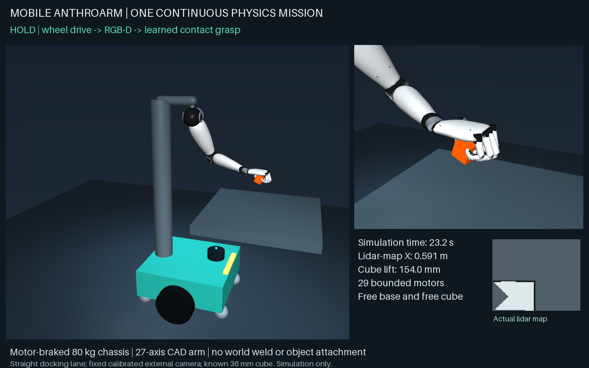

# AnthroArm: humanoid manipulation and mobile navigation

A Windows-based robotics simulation project combining a 27-axis anthropomorphic arm and hand, contact-based manipulation, camera targeting, wheeled navigation, and native ROS 2 interfaces. Native FreeCAD assemblies, STEP geometry, URDF/MuJoCo models, source code, recorded demonstrations, and measured test reports are included.

All reported performance is from simulation. The project does not include a built physical robot or a validated sim-to-real deployment.

## Demonstrations

| Recording | What it demonstrates |
|---|---|
| [Learned contact grasp — 18.6 seconds](results/integration/grasping/learned_contact_grasp.webm) | Camera targeting, finger closure, physical cube lift, hold, set-down, and release. |
| [Mapping and navigation — 24.3 seconds](results/integration/navigation/navigation_demo.webm) | Wheel-driven base, simulated range sensing, estimated pose, occupancy mapping, and obstacle-aware goal following. Playback is accelerated. |
| [Mounted mobile arm — 28.9 seconds](results/integration/mobile_manipulation/mobile_camera_grasp.webm) | Physical base docking followed by mounted-arm cube manipulation in a clear straight lane. |

GitHub may offer these WebM files as downloads. Open them in a browser or compatible media player. The local [simulation dashboard](integration/dashboard.html), served by the launcher below, provides recordings, live simulation controls, maps, and result links.

## Measured results

| Test | Recorded result | Evidence and scope |
|---|---|---|
| Frozen grasp controller | **10/10** held-out cases passed | [Final validation](results/integration/grasping/final_validation.json). Known upright cubes; contact, lift, hold, and release checks. Cancellation and empty-target rejection also passed. |
| RGB-D grasp targeting | **6/6** cases passed | [Camera report](results/integration/grasping/camera_report.json). Maximum target estimate error **1.48 mm** in the tested calibrated simulation; known object size is an input. |
| Mounted mobile manipulation | **3/3** trials passed | [Validation](results/integration/mobile_manipulation/validation.json). Approximately **0.61 m** base travel; minimum retained lift **153.95 mm**. Straight unobstructed docking lane. |
| Mapping and navigation | **7/7** goals reached | [Navigation report](results/integration/navigation/navigation_validation.json). Four survey goals and three held-out goals; zero obstacle-contact steps, pose RMSE **8.00 mm**. Held-out final true goal distances were **126.6–133.3 mm**, distinct from localization error. |
| Arm ROS 2 integration | **23/23** checks passed | [Bridge validation](results/integration/runtime/arm_bridge_validation.json). Real DDS joint, camera, depth, calibration and TF messages; trajectory feedback/cancel; simulated grasp and reset. |

The navigation [implementation checks](results/integration/navigation/implementation_checks.json) replay **1,217** sensor observations without simulator truth or geometry and reproduce the estimator and occupancy map exactly. The separate [navigation ROS test](results/integration/navigation/ros_pipeline_validation.json) passes six checks covering typed streams, velocity commands and watchdog, mission service, goal topic, and TF.

These are bounded engineering tests, not success-rate estimates for arbitrary objects, scenes, or hardware. Reports retain the parameters and detailed outcomes needed to interpret each result.

## How it works

**Arm and hand.** The current CAD assembly has 293 solids and 27 movable axes: seven arm axes and twenty hand axes. Native geometry and exported meshes feed the MuJoCo model. Contact uses rigid collision geometry; fingertip material deformation and a manufactured actuator/transmission system are not modeled in detail.

**Manipulation.** A size-conditioned affine regression predicts ten grasp parameters from six selected demonstrations obtained from 42 physical simulation search trials. Scripted stages and numerical inverse kinematics execute the predicted grasp. This is supervised parameter learning, not an end-to-end neural or reinforcement-learning controller. The cube is a free physical body: the validated pickup uses contacts, with no object weld or externally applied pickup force. See the [training report](results/integration/grasping/report.json) and [controller](integration/grasping/controller.py).

**Navigation.** Wheel encoders seed custom scan-to-map ICP; range observations update an 8 cm log-odds occupancy grid; inflated-grid A* and feedback wheel control drive to goals. Ground-truth pose is used for scoring, not navigation control. The initial pose is known. There is no global pose graph, explicit loop closure, or kidnapped-robot recovery. This implementation is not Nav2. See the [navigation source](integration/navigation/).

**Combined trial.** A separate 80 kg simulated mobile base carries the arm. The base docks using its lidar pose estimate, and calibrated RGB-D sensing supplies the cube target. Arm IK uses ideal simulated base pose and joint proprioception. This clear-lane experiment does not establish whole-room mobile manipulation or collision-free arm planning.

**ROS 2.** An isolated native Windows ROS 2 Jazzy runtime from the RoboStack community distribution communicates with separate MuJoCo processes through local HTTP. Actual DDS topics, services, actions, and TF were exercised. The arm and navigation simulations have distinct time/frame conventions; they are not a synchronized combined ROS physics world. Full Nav2 and MoveIt are not installed.

**Vision-language experiment.** Local PyTorch inference runs `HuggingFaceTB/SmolVLM-256M-Instruct` at a pinned revision. The raw-scene answer incorrectly described “a marker, a box and a paper”; a cropped target was correctly described as a cube. The [report](results/integration/vision_language/report.json) includes both outputs. This experiment has no motor-control authority and does not establish reliable scene understanding or a vision-language-action policy.

## Run locally

The tested layout is **`D:\RoboticArm` on Windows x64**. Several launchers, CAD scripts, and navigation modules use that absolute root. Running an export from another folder is not a validated portable installation and may access the original tree.

1. Follow [Setup and reproduction](docs/SETUP.md) on a separate machine or a fresh `D:\RoboticArm` workspace. Downloaded software, caches, and the large SmolVLM weights are reconstructed from the included manifests; they are not repository contents.
2. Run [`START_SIMULATION.cmd`](START_SIMULATION.cmd).
3. Open `http://127.0.0.1:8770` for recorded results and live simulated arm/base controls.
4. Run [`STOP_SIMULATION.ps1`](STOP_SIMULATION.ps1) from PowerShell to stop the integration services.

The services bind to this computer. The integration launcher operates simulation only. Historical hardware planning and unflashed single-finger firmware are separate from this runtime.

## Repository map

| Path | Contents |
|---|---|
| [design/v3](design/v3/) | Current native FreeCAD assembly, STEP, individual meshes, URDF, component descriptions, and CAD generation/validation scripts. |
| [simulation/v3](simulation/v3/) | MuJoCo arm model, RGB-D targeting, rendering and earlier arm tests. |
| [integration](integration/) | Current dashboard/backend, grasp learning/control, navigation, combined mobile manipulation, ROS bridges, and local VLM experiment. |
| [results/integration](results/integration/) | Current JSON evidence, measured trajectories, images, and videos. |
| [solidworks](solidworks/) | SOLIDWORKS preparation macros, transfer geometry, inventories, and historical execution evidence. See the qualification below. |
| [design/v3/printable_finger](design/v3/printable_finger/) | Separate tendon-finger fit-test CAD and eight printable STL parts. Physical fits, strength, and actuation remain unverified. |
| [docs](docs/) | Setup, component explanations, reference review, and historical prototype planning. |
| [docs/dependencies](docs/dependencies/) | Pinned Python package snapshots, ROS Pixi manifest/lock, model provenance, and software sources. |

Earlier design generations and reports remain available for traceability. Use `design/v3` and `integration` for the current arm and runtime rather than mixing earlier models with current result claims.

## CAD and validation boundaries

The repository contains actual native [FreeCAD](design/v3/AnthroArm27_ReferenceV3.FCStd) and [STEP](design/v3/AnthroArm27_ReferenceV3.step) assemblies. SOLIDWORKS evidence records a historical 28-part, 293-solid static assembly and native ZIP created in a remote trial, but that ZIP was not recovered before the session expired. **A recovered working native SOLIDWORKS assembly is not included.** Packaging test fixtures with `.SLDPRT` or `.SLDASM` extensions are not substitutes for it. A DIP motion attempt failed its signed-angle check; successful Motion or FEA studies are not claimed. See [SOLIDWORKS status](solidworks/START%20HERE.txt) and the [results ledger](solidworks/studies/native_results_ledger.json).

Also not demonstrated: physical assembly or sim-to-real accuracy, verified physical-webcam hand tracking, arbitrary-object grasping, general autonomous scene reasoning, full-room combined mobile manipulation, Isaac Sim/Lab execution, Jetson deployment, or a general whole-body policy. Joint effort saturation and transient joint-limit overshoot occur in the contact experiments and are retained in the evidence.

## Software and attribution

The tested stack includes Python 3.12.10, MuJoCo 3.14.0, NumPy 2.5.3, SciPy 1.18.1, OpenCV 5.0.0.93, FreeCAD 1.1.4, native ROS 2 Jazzy, PyTorch 2.8.0 CPU, and Transformers 4.53.3. ROS uses its own Python 3.12.15 environment. Exact snapshots and upstream sources are in [dependency documentation](docs/dependencies/SOFTWARE_SOURCES.md).

Third-party software, models, fonts, and formats retain their respective names, copyrights, and license terms. The repository does not redistribute installed software environments or the large SmolVLM weights. The included MediaPipe hand-landmark task asset retains its upstream provenance and license notice. Source and asset reuse is subject to the repository's applicable license and any third-party terms; no additional license grant is implied by this overview.

Project owner: [@NasirAli1993](https://github.com/NasirAli1993)
